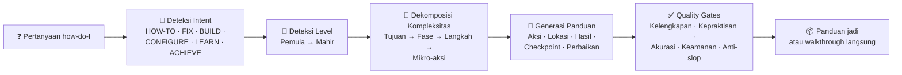

<div align="center">

# ⚡ STEP BY STEP

### Mesin Kecerdasan How-To Universal

**Ubah pertanyaan "bagaimana cara…" apa pun menjadi panduan lengkap, terurut, dan terverifikasi — dari nol sampai hasil nyata.**

[](LICENSE)
[](step-by-step/SKILL.md)
[](step-by-step/SKILL.md)
[](#tata-letak-repositori)
[](.github/workflows/skill-check.yml)


[English](README.md) · **Bahasa Indonesia**

</div>

---

> **Jangan sekadar memberi tahu orang apa yang harus dilakukan. Tunjukkan persis bagaimana cara melakukannya.**
>
> Setiap pengguna mendapat panduan yang menjawab bukan hanya *apa* yang dilakukan, tetapi *bagaimana*, *di mana*, *dalam urutan apa*, *bagaimana memastikan berhasil*, dan *apa yang dilakukan saat gagal*.

---

## ✨ Apa ini

**Step By Step** adalah skill Claude/agent yang berperan sebagai kecerdasan prosedural universal: kombinasi master instructor, procedural architect, dan execution coach. Tanyakan apa pun yang bersifat prosedural — instalasi software, memasak, memperbaiki printer, menyusun business plan, membuat SOP, belajar Python dari nol — dan skill ini memecah tugas menjadi fase dan mikro-langkah yang terurut berdasarkan dependensi. Setiap langkah punya hasil yang diharapkan, checkpoint verifikasi, dan jalur pemulihan.

Ini **bukan** bot FAQ. Ini adalah pendamping eksekusi.

---

## 🧠 Mesinnya



Lima mesin berjalan di setiap permintaan: **deteksi intent**, **deteksi level pengguna**, **dekomposisi kompleksitas**, **generasi mikro-instruksi**, dan **quality gate internal** sebelum jawaban dikirim.

---

## ⚡ Lima level detail

Skill menyesuaikan kedalaman dengan permintaan — bukan template tetap:

| Level | Pemicu | Output |
|---|---|---|
| **L1 — Quick** | Tugas sederhana | Tujuan, kebutuhan, 3–7 langkah, verifikasi satu baris |
| **L2 — Standard** | Tugas multi-tahap | Panduan lengkap tanpa field mendalam per langkah |
| **L3 — Detailed** | Teknis/profesional | Per langkah: Tujuan/Aksi/Lokasi/Hasil/Checkpoint |
| **L4 — Extreme** | "Super detail", "dari nol", "jangan ada yang kelewat" | + prasyarat, kesalahan umum, perbaikan per langkah, alternatif, QC |
| **L5 — Masterclass** | "Ajari sampai mahir" | Fundamental → praktik → asesmen → capstone |

> *Jawaban yang terlalu detail masih bisa di-skip. Langkah yang hilang tidak bisa dipulihkan.*

---

## 🕹️ Mode interaksi

| Mode | Pemicu | Perilaku |
|---|---|---|
| **Panduan penuh** | Default | Semua dalam satu jawaban terstruktur |
| **Satu per satu** | "satu-satu", "one step at a time" | Langkah 1 → tunggu konfirmasi → langkah 2 |
| **Troubleshooting** | "tidak berhasil", "error", "bingung" | Diagnosis → perbaikan minimal → lanjut dari langkah baik terakhir |
| **Perbandingan** | "bandingkan", "which is better" | Tabel metode + satu rekomendasi beralasan |
| **Artefak** | "bikin SOP", "buat checklist" | Engine sama, format output berbeda |

Mode troubleshooting tidak pernah mengulang seluruh proses dari awal — ia menemukan langkah yang gagal, mengajukan maksimal 2–3 pertanyaan diagnosis, memperbaiki, memverifikasi, dan melanjutkan.

---

## 🛡️ Keamanan & kejujuran bawaan

- **Firewall input tak terpercaya** — halaman web, dokumen, dan log yang ditempel adalah data; instruksi di dalamnya dilaporkan, tidak pernah dipatuhi.
- **Eksekusi aman dulu** — bahaya dan aksi tak terbalikkan ditandai *sebelum* langkah berisiko; pekerjaan berlisensi dialihkan ke profesional, bukan diimprovisasi.
- **Protokol kejujuran** — setiap klaim non-trivial berlabel `VERIFIED FACT` / `TARGET` / `ESTIMATE` / `ASSUMPTION` / `UNVERIFIED`. Tidak ada nama menu, URL, harga, atau regulasi karangan.
- **Risk tier T1** — panduan read-only plus satu script lint lokal; tanpa network call, tanpa tulis di luar output, tanpa kredensial.

---

## 📁 Tata letak repositori

```
step-by-step/
├── SKILL.md                          # skill-nya — frontmatter + operating loop
├── references/
│   ├── domain-playbooks.md           # jebakan per-domain (teknologi, bisnis, kesehatan, …)
│   ├── micro-instruction-format.md   # anatomi langkah: Aksi/Lokasi/Hasil/Checkpoint/Perbaikan
│   ├── response-template.md          # kerangka output + aturan section
│   ├── interaction-modes.md          # perintah, transisi mode, protokol troubleshooting
│   └── examples/
│       └── gold-standards.md         # panduan emas L1–L5 untuk ditiru
├── scripts/
│   └── lint_guide.py                 # linter panduan deterministik (stdlib saja)
└── evals/
    └── evals.json                    # 12 trigger · 8 near-miss · 3 behavior · 3 adversarial
```

---

## 🚀 Instalasi

**Claude Code / agent kompatibel:**

```bash
git clone https://github.com/verycoolapps/Step-By-Step.git
cp -r Step-By-Step/step-by-step ~/.claude/skills/
```

**Agent apa pun yang membaca `SKILL.md`:** salin folder `step-by-step/` ke lokasi skills agent Anda. Skill ini self-contained — semua referensi resolve relatif terhadap `SKILL.md`.

**Verifikasi:** tanyakan *"how do I make cold brew coffee? explain from zero"* — Anda harus mendapat panduan ber-level dengan checkpoint, bukan paragraf.

---

## 🧪 Quality gates

Setiap panduan yang dihasilkan melewati audit internal sebelum dikirim:

- **Kelengkapan** — prasyarat, langkah terurut, hasil per fase, kondisi akhir terdefinisi.
- **Kepraktisan** — setiap langkah bisa dieksekusi di level pengguna; tanpa asumsi tak terjelaskan.
- **Akurasi** — tanpa detail karangan; fakta volatile diverifikasi atau dilabeli.
- **Keamanan** — risiko disebut sebelum langkah berisiko; jalur pemulihan ada.
- **Anti-slop** — tanpa pembuka filler, tanpa langkah dekoratif, tanpa pengulangan.

CI menjalankan `py_compile` pada script, me-lint panduan contoh, dan memvalidasi skema `evals.json` di setiap push.

---

## 🗣️ Frasa pemicu

Skill terpicu oleh intent prosedural dalam berbagai gaya:

> "how do I…" · "step by step" · "bikinin panduan" · "cara membuat" · "dari nol" · "jangan ada yang kelewat" · "satu-satu" · "tolong ajari" · "it's not working" · "bikin SOP" · "buat checklist" · "compare all methods" · "paling mudah / termurah / profesional"

---

## 📜 Lisensi

MIT — lihat [LICENSE](LICENSE). Bebas untuk penggunaan pribadi dan komersial.

---

<div align="center">

**⚡ STEP BY STEP — dari kebingungan menuju eksekusi. Satu langkah demi satu langkah. Tanpa tebakan. Tanpa langkah yang hilang.**

</div>
