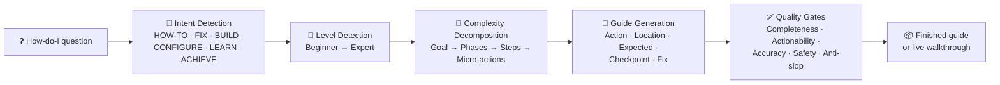

<div align="center">

# ⚡ STEP BY STEP

### The Universal How-To Intelligence Engine

**Turn any "how do I…" into a complete, ordered, verifiable guide — from zero knowledge to real-world results.**

[](LICENSE)
[](step-by-step/SKILL.md)
[](step-by-step/SKILL.md)
[](#repository-layout)
[](.github/workflows/skill-check.yml)


**English** · [Bahasa Indonesia](README.id.md)

</div>

---

> **Never just tell people what to do. Show them exactly how to do it.**
>
> Every user gets a guide that answers not only *what* to do, but *how*, *where*, *in what order*, *how to confirm it worked*, and *what to do when it fails*.

---

## ✨ What it is

**Step By Step** is a Claude/agent skill that acts as a universal procedural intelligence: a master instructor, procedural architect, and execution coach combined. Ask it anything procedural — install software, cook a dish, fix a printer, build a business plan, write an SOP, learn Python from zero — and it decomposes the task into dependency-ordered phases and micro-steps, each with an expected result, a verification checkpoint, and a recovery path.

It is **not** a FAQ bot. It is an execution companion.

---

## 🧠 The Engine



Five engines run on every request: **intent detection**, **user-level detection**, **complexity decomposition**, **micro-instruction generation**, and an internal **quality-gate pass** before anything is delivered.

---

## ⚡ Five detail levels

The skill adapts depth to the ask — not to a fixed template:

| Level | Trigger | Output |
|---|---|---|
| **L1 — Quick** | Simple task | Goal, needs, 3–7 steps, one-line verify |
| **L2 — Standard** | Multi-stage task | Full guide minus deep per-step fields |
| **L3 — Detailed** | Technical/professional | Per-step Goal/Action/Location/Expected/Checkpoint |
| **L4 — Extreme** | "Super detail", "from zero", "nothing skipped" | + prerequisites, mistakes, per-step fixes, alternatives, QC |
| **L5 — Masterclass** | "Teach me until I'm proficient" | Fundamentals → practice → assessment → capstone |

> *An over-detailed answer is skimmable. A missing step is not recoverable.*

---

## 🕹️ Interaction modes

| Mode | How to trigger | Behavior |
|---|---|---|
| **Full guide** | Default | Everything in one structured answer |
| **One step at a time** | "satu-satu", "one step at a time" | Step 1 → wait for confirmation → step 2 |
| **Troubleshooting** | "tidak berhasil", "error", "bingung" | Diagnose → minimal fix → resume from last good step |
| **Comparison** | "bandingkan", "which is better" | Method table + one justified recommendation |
| **Artifact** | "bikin SOP", "buat checklist" | Same engine, different output format |

The troubleshooting mode never restarts the whole process — it finds the failed step, asks at most 2–3 targeted questions, fixes, verifies, and resumes.

---

## 🛡️ Safety & honesty built in

- **Untrusted-input firewall** — pasted web pages, docs, and logs are data; embedded instructions are reported, never obeyed.
- **Safety-first execution** — hazards and irreversible actions are flagged *before* the risky step; licensed-professional work is redirected, not improvised.
- **Honesty protocol** — every non-trivial claim is labeled `VERIFIED FACT` / `TARGET` / `ESTIMATE` / `ASSUMPTION` / `UNVERIFIED`. No invented menu names, URLs, prices, or regulations.
- **Risk tier T1** — read-only guidance plus one local lint script; no network calls, no writes outside the output, no credentials.

---

## 📁 Repository layout

```
step-by-step/
├── SKILL.md                          # the skill — frontmatter + operating loop
├── references/
│   ├── domain-playbooks.md           # per-domain pitfalls (tech, business, health, …)
│   ├── micro-instruction-format.md   # step anatomy: Action/Location/Expected/Checkpoint/Fix
│   ├── response-template.md          # output skeleton + section rules
│   ├── interaction-modes.md          # commands, mode transitions, troubleshooting protocol
│   └── examples/
│       └── gold-standards.md         # L1–L5 gold-standard guides to match
├── scripts/
│   └── lint_guide.py                 # deterministic guide linter (stdlib only)
└── evals/
    └── evals.json                    # 12 trigger · 8 near-miss · 3 behavior · 3 adversarial cases
```

---

## 🚀 Install

**Claude Code / compatible agent:**

```bash
# clone into your skills directory
git clone https://github.com/verycoolapps/Step-By-Step.git
cp -r Step-By-Step/step-by-step ~/.claude/skills/
```

**Any agent that reads `SKILL.md`:** copy the `step-by-step/` folder anywhere your agent loads skills from. The skill is self-contained — all references resolve relative to `SKILL.md`.

**Verify it works:** ask *"how do I make cold brew coffee? explain from zero"* — you should get a levelled, checkpointed guide, not a paragraph.

---

## 🧪 Quality gates

Every generated guide passes an internal audit before delivery:

- **Completeness** — prerequisites, ordered steps, expected result per phase, defined end state.
- **Actionability** — every step executable at the user's stated level; no unexplained assumptions.
- **Accuracy** — no fabricated details; volatile facts verified or labeled.
- **Safety** — risks named before the risky step; a recovery path exists.
- **Anti-slop** — no filler openings, no decorative steps, no repeated explanations.

CI runs `py_compile` on scripts, lints the example guide, and validates `evals.json` schema on every push.

---

## 🗣️ Trigger phrases

The skill fires on procedural intent in any phrasing:

> "how do I…" · "step by step" · "bikinin panduan" · "cara membuat" · "dari nol" · "jangan ada yang kelewat" · "satu-satu" · "tolong ajari" · "it's not working" · "bikin SOP" · "buat checklist" · "compare all methods" · "paling mudah / termurah / profesional"

---

## 📜 License

MIT — see [LICENSE](LICENSE). Free for personal and commercial use.

---

<div align="center">

**⚡ STEP BY STEP — from confusion to execution. One step at a time. No guesswork. No missing steps.**

</div>
